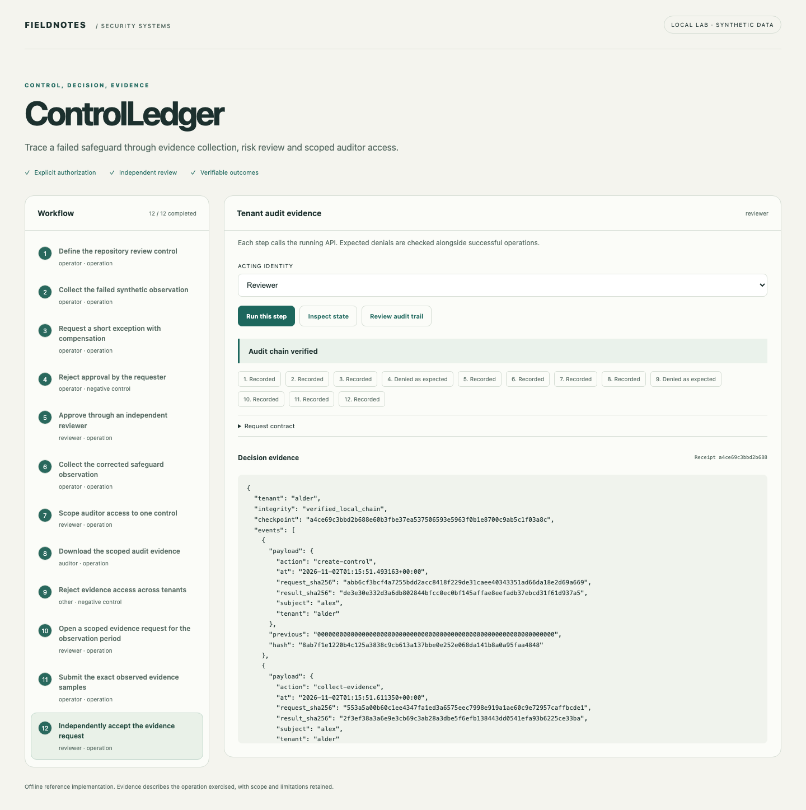
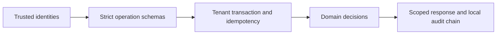

# ControlLedger

[](https://github.com/jayekwere/controlledger/actions/workflows/verify.yml) [MIT](LICENSE)

**Control evidence that stays inspectable from observation to audit request.**

Create explicitly owned controls, import timestamped observations, distinguish missing and stale evidence from failure, review bounded exceptions and grant auditors access to exact controls.



## Run locally

Python 3.14 and Node 24 through 26. Initial dependency installation requires network access. All core demonstrations run offline after setup. Each repository is independent and ships its own lockfiles.

```sh
git clone https://github.com/jayekwere/controlledger.git
cd controlledger
python3 -m venv .venv
. .venv/bin/activate
python -m pip install --require-hashes -r requirements-dev.lock
npm ci --ignore-scripts
npm run build
python -m app.cli demo
python -m app.cli serve --demo
```

Open [the local workbench](http://127.0.0.1:8080). Run steps in order. The acting identity and expected denial are visible before each operation. Each step submits a real API request, and results are rendered as text. Demo credentials are public synthetic fixtures. Use them only on the private local lab.

The CLI uses temporary state and leaves the served workbench independent. The server persists its synthetic state in `artifacts/state.db`; select a new `STATE_PATH` for a fresh exercise. CLI records use a fixed observation clock where possible. The committed sample output is generated from the executable scenario, not hand-authored findings.

```sh
docker compose up --build
# Stop and discard the temporary container workspace:
docker compose down
```

Compose publishes only to loopback. It uses a non-root UID, read-only root filesystem, dropped capabilities, a private temporary state area, a memory limit and a process limit. Temporary container state is discarded when the container is removed.

## Evidence and implementation

Each control defines one supported boolean safeguard and a freshness window. Evidence is immutable after ingestion and retains a hash of its imported source, a source reference, collection identity and observed time. The latest observed sample determines the displayed state; an accepted exception remains separate from that state. Auditor grants bind a subject to explicit controls and expire after at most seven days. Every download passes that scope check before returning evidence. Required approvals and cloud encryption are narrow observations rather than whole-system compliance conclusions.



The shared architecture pattern is small Python FastAPI domain services with SQLite transactions and a TypeScript workbench. The domain logic is specific to this project. JSON input contracts reject unknown fields and type coercion. SQL is parameterized for tenant data. All state changes and successful operation receipts commit together. Replay keys bind actor, roles, action and payload. Audit events retain digests rather than request contents. Local chains detect accidental edits; a database writer can recompute a chain, so an independent checkpoint is necessary for stronger tamper evidence.

## Verify

```sh
npm run verify
python -m ruff check app tests
python -m ruff format --check app tests
python -m mypy app
python -m pytest
npx playwright install chromium
npm run test:browser
docker build -t controlledger:local .
node scripts/container-smoke.mjs controlledger:local
```

Browser tests require fresh `artifacts/browser-state.db` state. See [verification evidence](docs/verification.md), [architecture](docs/architecture.md), [threat model](docs/threat-model.md), [security design](docs/security-design.md), [API](docs/api.md) and [schemas](schemas/contracts.json). Hosted CI enforces at least 80% Python statement/branch coverage and runs browser, dependency, exact-fixture or semantic-demo, and restricted-container checks. Coverage describes executed code and is not a security score.

## Optional native reads

Only run collectors against explicitly authorized resources. Exports are written exclusively to private local files and must be reviewed before sharing. Native reads are separate from the offline scenario.

```sh
python -m app.collectors github --repository jayekwere/controlledger --branch main --output artifacts/github.json
python -m app.collectors aws --bucket YOUR_AUTHORIZED_BUCKET --profile cloud-admin --output artifacts/aws.json
```

## Limits

No SOC 2 attestation, ISO 27001 certification or guarantee of sustained control operation. Samples do not establish continuous operation across an audit period. Framework references are illustrative mapping labels, not licensed framework text or an authoritative mapping. Imported observations and hashes are assertions by an authorized collector operator. The API does not independently authenticate upstream exports. Vanta exports are a supported provenance label only; there is no native Vanta account connector. GitHub branch rulesets and administrative bypass are outside the branch-protection collector scope. AWS collection observes a bucket default, not historical object encryption or key access.

The service is a bounded single-node reference implementation. It supports at most 200 records per kind and 5,000 successful audit events per tenant before requiring a new workspace or deliberate archival work. Bearer identities are server-configured; there is no external identity provider, distributed scheduler, managed key service or production deployment. The offline browser interface is available only in explicit demo mode. Configured API mode requires a private identity file, accepts no demo tokens and remains intended for local evaluation. No security certification or exhaustive vulnerability guarantee is claimed.

See [SECURITY.md](SECURITY.md) and [CONTRIBUTING.md](CONTRIBUTING.md).

The audit request workflow pins explicit controls and an observation period. Fulfillment must cover that exact scope using immutable evidence records. Independent acceptance binds the fulfillment digest. Sample coverage remains distinct from sustained operation. The latest evidence also provides a next-test due timestamp.

[Native GitHub collector acceptance](docs/github-native-verification.json) records a real read against this repository. It preserves the observed failing safeguard rather than presenting collection success as control success. AWS collector acceptance remains limited to synthetic native-response contract tests.
